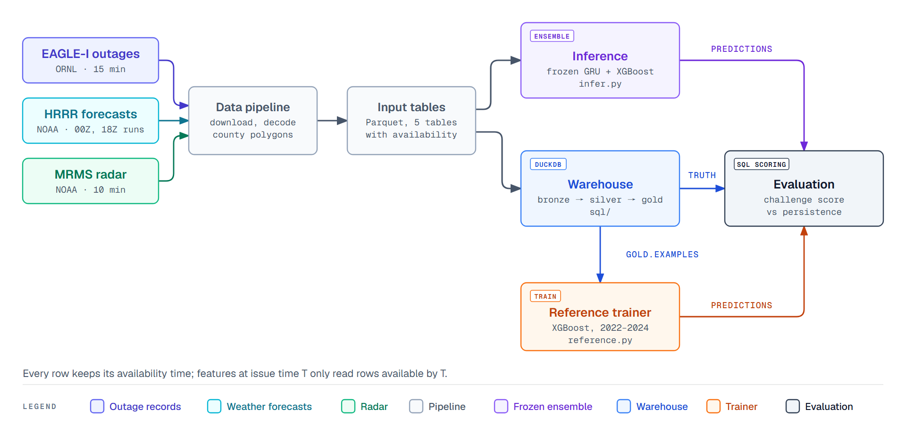
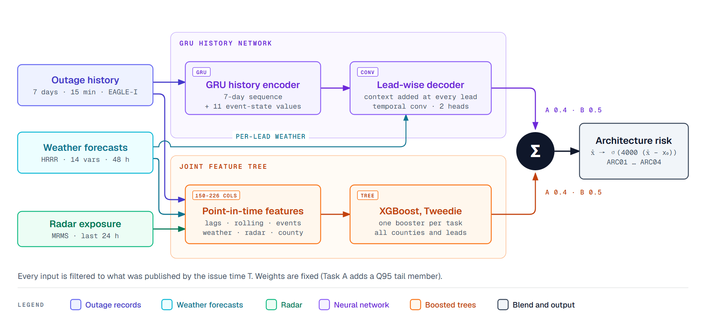
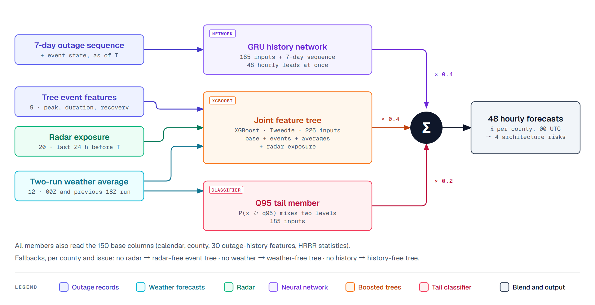
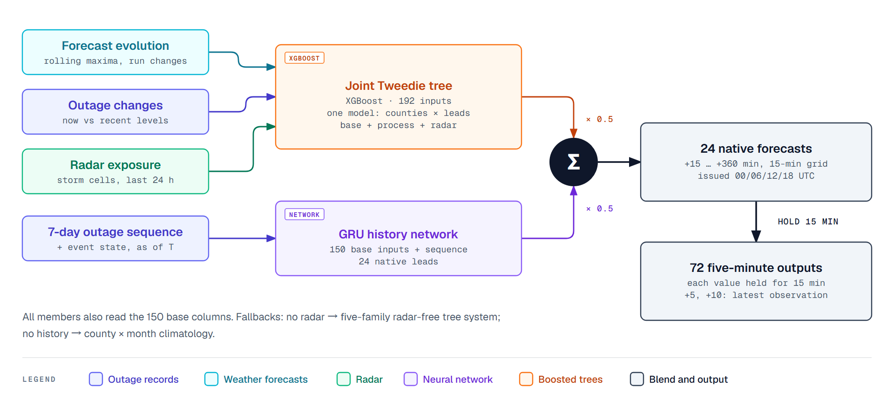

# Weather-Driven Power-Outage Risk Forecasting for AI Data Centers

[](https://github.com/lishuangyi/weather-driven-outage-risk-forecasting/actions/workflows/ci.yml)


Forecasts the share of customers without power in five US counties, 48 hours ahead (hourly) and 6 hours ahead
(every 5 minutes). Each forecast is then mapped to a grid-supply risk score for four AI data-center power
architectures. All inputs are public: EAGLE-I outage records and NOAA HRRR weather forecasts and MRMS radar.

- **Point-in-time features.** A forecast issued at time T reads only data published by T. Tests enforce this by
  changing all later data.
- **Two implementations of the data layer.** Python (polars) for inference and DuckDB SQL (bronze → silver → gold)
  for features, labels, quality checks and scoring. Parity tests show that both give the same results.
- **Frozen ensemble.** GRU history network and XGBoost Tweedie trees, with fallback models when radar, weather or
  outage history is missing.
- **Reproducible.** Pinned dependencies, SHA-256-checked release artifacts, offline CPU inference and CI.

## Quick start

Requires Python 3.12 on Linux or WSL. The repository and its release assets are private for now, so use an
account with access and an authenticated GitHub CLI (`gh auth login`).

```bash
git clone https://github.com/lishuangyi/weather-driven-outage-risk-forecasting.git
cd weather-driven-outage-risk-forecasting
make setup            # CPU environment: pinned requirements + editable install
make models data      # frozen models (39 MB) + June–August 2025 inputs (75 MB), SHA-256 verified
make test             # test suite on a 2-day input in tests/fixtures (13,440 requests)
make predict          # out/predictions.csv: 618,240 forecasts, about 1 min on CPU
make warehouse        # out/warehouse.duckdb: features, labels, quality checks, scores
```

## System overview



The data pipeline turns the public archives into five county-level input tables. Each row keeps the time it became
available. Two paths read these tables:

- **Inference** runs the frozen ensemble and writes forecasts.
- **The DuckDB warehouse** builds point-in-time features and labels. Its training table feeds the reference trainer.

Both prediction paths are scored by the same SQL metric against the same truth and a persistence baseline.

## Model

Both tasks share one core: a GRU over the last 7 days of outages, and a joint XGBoost feature tree over outage
history, weather forecasts and radar.



<details>
<summary><b>Task A</b>: three members, 48 hourly forecasts</summary>


</details>

<details>
<summary><b>Task B</b>: two members on the 15-minute grid, held to 5-minute outputs</summary>


</details>

Features, members and design choices are in [docs/MODEL.md](docs/MODEL.md). The fallback routes are in
[docs/MISSING_INPUTS.md](docs/MISSING_INPUTS.md).

## Benchmarks

These are local scores with the challenge formula: 100 × (0.75 × normalised AUPRC + 0.25 × (1 − MAE)) on the risk
scale, pooled over counties, architectures, issues and leads. They are not certified by the organisers. Persistence
holds the latest observation and is scored on the same cases.

| Model | Data window | Role of the window in development | Task A model / persistence | Task B model / persistence |
|---|---|---|---:|---:|
| Frozen ensemble | 2022–2024 | training | — | — |
| Frozen ensemble | 2025-06 to 2025-08 | member and weight selection | 54.45 / 38.69 | 75.13 / 65.88 |
| Frozen ensemble | rest of 2025 (9 months) | retrospective, not used for selection¹ | 55.00 / 46.92 | 72.75 / 66.59 |
| Reference trainer | 2022 fit, 2023 select, 2024 test, 2025 retrospective | from scratch, see [TRAINING.md](docs/TRAINING.md) | re-run pending² | re-run pending² |

¹ January–May 2025 informed one decision: we rejected a fallback-routing change because of its January–May score.
² The published v1 numbers were affected by a data-loading bug (missing labels read as zeros). The trainer is being
fixed and re-run.

Scores come from the full-year 2025 inputs, with windows defined by UTC issue time. On the June–August package used by
`make predict`, truth ends on 31 August, and the same forecasts score 54.52 / 38.82 and 75.13 / 65.88. All
breakdowns are in [docs/RESULTS.md](docs/RESULTS.md): by lead, county, architecture and month, plus robustness to
missing or delayed inputs, calibration, and an example storm.

## Usage

| Task | Command |
|---|---|
| Forecast an input directory | `python infer.py --input-dir <dir> --output <file.csv>` |
| Build the SQL warehouse and score a forecast file | `python -m outage_forecast.warehouse build --input-dir <dir> --predictions <file.csv>` |
| Run an analysis query | `python -m outage_forecast.warehouse query sql/analysis/model_vs_persistence.sql` |
| Train the reference model | `python scripts/download_artifacts.py training full-2025 && make train` |
| Demo with a summary page | `make demo` (see [docs/DEMO.md](docs/DEMO.md)) |
| Rebuild the inputs from public archives | `bash data_pipeline/build_inputs.sh --start 2025-06-01 --end 2025-09-01` (see [docs/DATA.md](docs/DATA.md)) |

Input tables are Parquet or CSV in the layout described in [docs/DATA.md](docs/DATA.md). A forecast file has one row
per request: `task_id, architecture_id, county_fips, issue_time, target_time, predicted_x, predicted_risk`.

## Testing and CI

On every push, GitHub Actions installs the CPU environment, runs `ruff`, downloads the frozen models and runs
`pytest` on the 2-day fixture. The tests cover:

- end-to-end inference against recorded predictions;
- no lookahead: changing later data leaves earlier forecasts bit-identical;
- input validation;
- SQL against Python parity for the 30 history features, the labels and the scores;
- the metric against scikit-learn;
- the reference trainer's output format.

Two checks need local data and are skipped in CI: full-window parity (June–August 2025) and the reference training run.

## Project structure

```
src/outage_forecast/   inference package; warehouse.py (SQL runner), reference.py (trainer), metrics.py
sql/                   bronze/ silver/ gold/ scoring/ analysis/ (DuckDB)
configs/               runtime configuration: feature schemas, member weights, fallbacks, model SHA-256
data_pipeline/         builds the input tables from HRRR, MRMS, EAGLE-I and Census polygons
demo/  notebooks/      demo runner with summary page; notebook front end
tests/                 pytest suite and 2-day fixture
docs/                  model, data, SQL, training, results, model card; diagrams/ (generator + HTML)
```

## Documentation

[Model card](docs/MODEL_CARD.md) · [Results](docs/RESULTS.md) · [Model](docs/MODEL.md) ·
[Temporal correctness](docs/TEMPORAL_CORRECTNESS.md) · [Missing inputs](docs/MISSING_INPUTS.md) ·
[SQL warehouse](docs/SQL.md) · [Training](docs/TRAINING.md) · [Data](docs/DATA.md) · [Demo](docs/DEMO.md) ·
[Roadmap](docs/ROADMAP.md)

## Limitations

- **Replay assumptions.** Publication times are assumed, because the archives do not record them. Delaying outage
  records by 3 min and weather runs by 4 h lowers the scores to 49.77 / 72.97.
- **Scope.** Five counties, one evaluation year, and a fixed issue grid. Task B models the 15-minute series and does
  not resolve 5-minute dynamics.
- **Training code.** The frozen weights come from experiment code that is not included. The reference trainer is the
  reproducible training path.

## Background, data and licence

This project started as my entry to Huawei TechArena 2026 (Topic 2, Challenge 2). This repository is an independent,
cleaned-up version, and no challenge materials are included. Code and models are by
[@lishuangyi](https://github.com/lishuangyi).

Data: EAGLE-I (ORNL, CC BY 4.0), NOAA HRRR and MRMS (public domain), US Census TIGER/Line (public domain). See
[DATA_LICENSES.csv](DATA_LICENSES.csv). The code is licensed under the [MIT licence](LICENSE).
