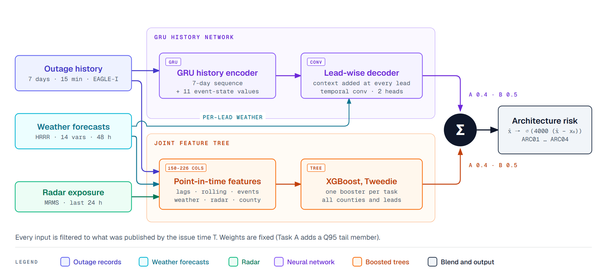
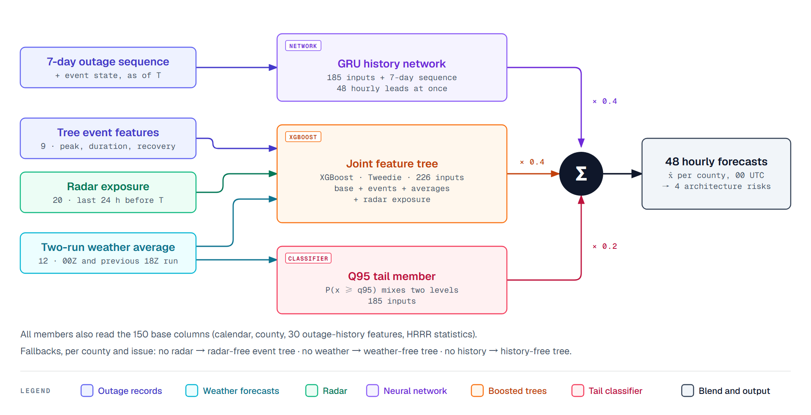
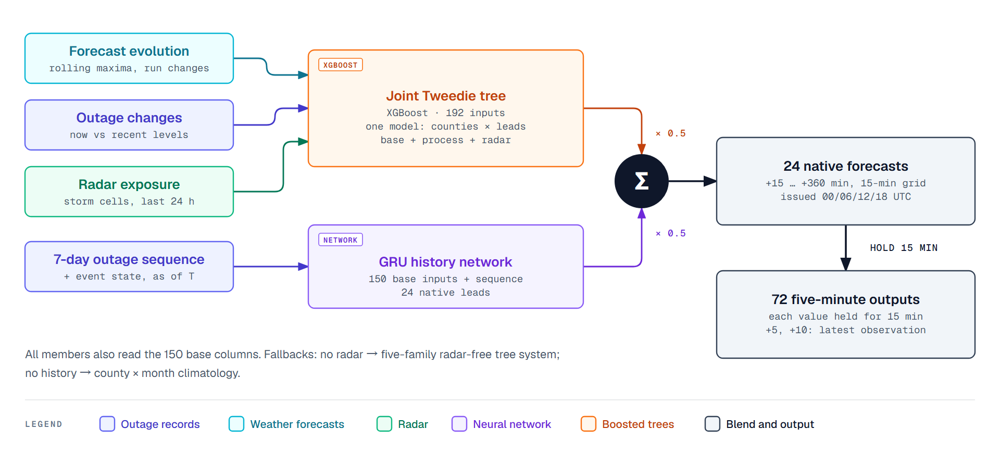

# Models

All models were fitted on outage labels of 2022–2024 (40 counties: the 5 forecast counties and 35 neighbours). They are
loaded read-only, and nothing is refitted at inference. Every file is listed with its SHA-256 in
`configs/inference.json`, and the run stops if a file is missing or changed.

## Features (all computed as of the issue time T)

| Group | Columns | Source |
|---|---|---|
| Outage history | latest value and its age, lags 15 min–24 h, rolling mean/max/min over 1–24 h, slopes, missing-input count | EAGLE-I records with `timestamp ≤ T` and `source_record_time ≤ T` (latest revision wins) |
| Event state | 9 `ev_*` columns: the outage under way (peak, duration, recovery) over the last 168 h | same |
| Weather | county mean / std / max / p95 of 14 HRRR variables (temperature, dew point, wind, gusts, CAPE, humidity, pressure, cloud, visibility, precipitation, snow …) at the target hour; the previous-day 18Z run is averaged in as lag columns | HRRR runs with `model_run_time ≤ T` and `availability_time ≤ T` |
| Radar | reflectivity exposure (share of county ≥ 35 / 50 dBZ, max dBZ, 35 dBZ ring) over the last 24 h | MRMS frames with `availability_time ≤ T` |
| Sequence | 7 days of 15-minute values (240 steps × 6 channels) plus 11 event-state values | outage history |

Feature code: `src/outage_forecast/features/` (`history.py`, `weather.py`, `radar.py`, `base.py`).

## Members

| File | Model | Role |
|---|---|---|
| `task_a/gru/weights.pt`, `task_a/gru/normalizer.npz` | GRU history network (`networks.py`) | Task A member, weight 0.4 |
| `task_a/joint_tree.ubj` | XGBoost, Tweedie, 226 inputs (weather, run-averaged lags, event features, radar) | Task A member, weight 0.4 |
| `task_a/q95_tail.ubj` | XGBoost classifier P(x ≥ Q95), mixed as (1 − p)·μ0 + p·μ1 | Task A member, weight 0.2 |
| `task_a/fallback_no_radar_event_tree.ubj` | XGBoost, 194 inputs | replaces the joint tree without radar |
| `task_a/fallback_no_weather.ubj` | XGBoost, 150 inputs, log-ratio to persistence | Task A without usable weather |
| `task_a/fallback_no_history.ubj` | XGBoost, 185 inputs, trained with masked inputs | Task A without outage history |
| `task_b/gru.pt` | GRU history network (checkpoint with schema and normalisers) | Task B member, weight 0.5 |
| `task_b/joint_tree_tweedie.ubj` | XGBoost, Tweedie, 192 inputs (weather, process features, radar) | Task B member, weight 0.5 |
| `task_b/fallback_no_radar/<family>/<region>/<head>.ubj` | five tree families, 116 boosters: shared / regional ladder and level heads, long-lead ladder (`tree_heads.py`) | replaces the joint tree without radar |
| `task_b/fallback_no_history_climatology.json` | monthly median outage share per county | Task B without outage history |

Predictions are `clip(Σ weight × member, 0, 1)`. Task B is predicted on 15-minute leads and held over each 5-minute
target. The routing between members and fallbacks is decided per county and issue, and each run reports the path
it used on stderr.

## Design notes

- **Why Tweedie trees.** The outage share is zero-inflated and heavy-tailed. A Tweedie objective fits the mean
  without a log transform that would shrink the large events, and the large events decide the risk score.
- **Why a GRU next to the trees.** The tree features summarise history with fixed lags and windows. The GRU reads the
  raw 7-day sequence and the current event state, so it can follow the shape of a restoration curve. The two members
  make different errors, and blending them improved the selection score.
- **Q95 tail member (Task A).** A classifier for "above the 95th percentile" mixes two conditional means. It helps
  the ranking part (AUPRC) of the metric around the risk thresholds.
- **Fallbacks instead of imputation.** Each missing-input case has its own model, trained without that input, so a
  missing radar feed never turns into a fake "no rain" value.
