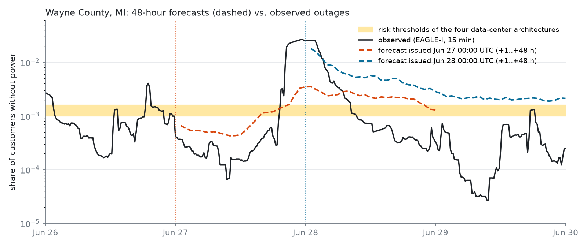

# Results

All scores use the challenge formula on our EAGLE-I truth: per task, pooled over counties, architectures, issues and
leads, 100 × (0.75 × normalised AUPRC + 0.25 × (1 − MAE)) on the risk scale. They are local scores, not results
certified by the organisers. The benchmark tables are generated from a versioned run report (section 10), and every
table can be recomputed with the SQL warehouse ([SQL.md](SQL.md)):

```bash
make predict warehouse                                       # June–August 2025
python -m outage_forecast.warehouse query sql/analysis/model_vs_persistence.sql
```

Persistence holds the latest visible observation for every lead. It is the natural baseline for outages, which
usually last longer than a few hours.

## 1. Headline

<!-- run-report:headline -->
| Window (UTC issue time) | Role of the window in development | Task A model / persistence | Task B model / persistence |
|---|---|---:|---:|
| 2025-06-01 to 2025-08-31 | member and weight selection | **54.45** / 38.69 | **75.13** / 65.88 |
| the other 9 months of 2025 | retrospective; January–May informed one fallback decision | **55.00** / 46.92 | **72.75** / 66.59 |
| all of 2025 | selection window and retrospective months together | **54.88** / 43.92 | **73.44** / 66.33 |
| 2025-06-01 to 2025-08-31, `input_2025` package | the June–August package of `make predict`; truth ends on 31 August | **54.52** / 38.82 | **75.13** / 65.88 |
<!-- /run-report:headline -->

The first three rows use the full-year 2025 inputs. The last row is the June–August package that `make predict`
uses: its truth ends on 31 August, so the last issues lose part of their targets. The breakdowns in section 2 use
that package. All rows are generated from the run report (section 10).

The gain over persistence is smaller on the retrospective months: Task A +8.1 against +15.8 in the selection window,
Task B +6.2 against +9.3. Part of the difference comes from the selection itself and part from the season: summer has
more storm-driven outages, and those are where the model gains most. With one year of data these two effects cannot
be separated. On June–August the gain comes mostly from ranking (normalised AUPRC: A 0.44 against 0.24 for
persistence, B 0.70 against 0.58). The risk MAE improves as well (A 0.134 against 0.160, B 0.083 against 0.100).

## 2. June–August 2025 broken down

These breakdowns are diagnostics. AUPRC does not average across groups, so the rows do not add up to the pooled score.

**By lead** (event rate 9–15 % in every band)

| Task A lead | 1–6 h | 7–12 h | 13–24 h | 25–48 h |
|---|---:|---:|---:|---:|
| score | 77.94 | 64.46 | 51.54 | 45.36 |

| Task B lead | 5–15 min | 20–60 min | 65–180 min | 185–360 min |
|---|---:|---:|---:|---:|
| score | 98.38 | 89.05 | 76.37 | 68.44 |

**By county** (model / persistence)

| County | Event rate (A) | Task A | Task B |
|---|---:|---:|---:|
| Wayne, MI (Detroit) | 16.4 % | 58.39 / 34.31 | 79.57 / 73.23 |
| Harris, TX (Houston) | 10.4 % | 39.08 / 24.12 | 53.62 / 42.09 |
| Rockingham, NH | 12.8 % | 37.29 / 22.82 | 51.13 / 36.25 |
| Los Angeles, CA | 3.5 % | 27.39 / 25.28 | 41.49 / 38.11 |
| Miami-Dade, FL | 21.6 % | 71.22 / 70.09 | 88.27 / 86.18 |

Rockingham's scores rest on far fewer cases than the others: only about a quarter (A) to a third (B) of its requests
have truth (section 8). The gains are largest where outages come and go with storms (Wayne, Harris, Rockingham). They are smallest where
outage levels persist (Miami-Dade) or events are rare and small (Los Angeles).

**By architecture**: Task A ranges from 53.02 (ARC01, x₀ = 0.100 %) to 55.78 (ARC04, x₀ = 0.160 %), and Task B from
72.97 to 77.46. Lower thresholds turn more small outages into events, which makes them harder to rank.

## 3. 2025 month by month (frozen ensemble against persistence)

| Month | 01 | 02 | 03 | 04 | 05 | 06 | 07 | 08 | 09 | 10 | 11 | 12 |
|---|---:|---:|---:|---:|---:|---:|---:|---:|---:|---:|---:|---:|
| Task A gain | −0.2 | −4.3 | +17.9 | +5.3 | +5.5 | +14.1 | +12.7 | +11.6 | +10.4 | +22.4 | +12.1 | +18.3 |
| Task B gain | +1.9 | +2.4 | +2.2 | +2.0 | +1.8 | +8.7 | +8.5 | +8.6 | +10.3 | +11.7 | +11.7 | +9.7 |
| event rate (A) | 22 % | 14 % | 8 % | 5 % | 7 % | 21 % | 11 % | 7 % | 6 % | 7 % | 5 % | 6 % |

The model beats persistence in every month for Task B, and in 10 of 12 months for Task A. The two exceptions are
January and February, the months of the multi-day Los Angeles wildfire outages, when holding the last value is
nearly perfect.

## 4. Robustness (June–August 2025)

| Condition | Task A | Task B |
|---|---:|---:|
| all inputs | 54.52 | 75.13 |
| no radar (fallback models) | 53.79 | 74.65 |
| only the 5 basic weather fields, no radar | 42.27 | 72.86 |
| outage records 3 min late, weather runs 4 h late | 49.77 | 72.97 |
| no outage history at all | 33.04 | 24.72 |

See [MISSING_INPUTS.md](MISSING_INPUTS.md) for the fallback routes and [TEMPORAL_CORRECTNESS.md](TEMPORAL_CORRECTNESS.md)
for the delay experiment.

## 5. Reference model trained from scratch

<!-- run-report:reference -->
| Evaluation (Task A / B) | Reference | Persistence | Frozen ensemble |
|---|---:|---:|---:|
| 2024 chronological test | **55.01 / 72.54** | 49.75 / 69.56 | in its training data |
| 2025 full year (retrospective) | 44.30 / 68.87 | 43.92 / 66.33 | **54.88 / 73.44** |
| 2025 June–August | 42.62 / 69.19 | 38.69 / 65.88 | **54.45 / 75.13** |
<!-- /run-report:reference -->

These are v2 results, after a fix on 2026-11-18. The v1 results were withdrawn because missing labels had been read as
zeros. [TRAINING.md](TRAINING.md) has the protocol, the selection table, the monthly results and the revision
history.

## 6. Calibration and events

The predicted risk is calibrated below 0.5 and over-confident above it. In the top bin, Task A predicts 0.98 and
0.64 of those cases are events; Task B predicts 0.99 and 0.88 are events (`sql/analysis/reliability.sql`). All five
Miami-Dade peaks and four of the five Wayne peaks got risk ≥ 0.97 from the issue 0–24 h earlier. The small Los
Angeles peaks were missed (`sql/analysis/largest_events.sql`).

## 7. Example: Wayne County storm, June 2025



This is a selected case, not a typical one. Two Task A forecasts for Wayne County (Detroit) are drawn against the
observed outage share, on a log scale; the band marks the four architecture thresholds. The forecast issued on
27 June at 00:00 UTC rises into the risk band about a day before the storm peak, which reaches about 2.6 % of
customers. The forecast issued on 28 June follows the restoration but decays more slowly than the real recovery.
The figure is made by `scripts/make_figures.py`.

## 8. Coverage: which requests can be scored

The model and persistence are scored on one cohort: the requests whose truth is available and valid. Requests
without truth are excluded and counted (`sql/analysis/coverage.sql`; rules in [SQL.md](SQL.md#scoring-one-cohort-for-every-model)).

<!-- run-report:coverage -->
| 2025, full year | Task A scored / requested | Share | Lowest month | Task B scored / requested | Share | Lowest month |
|---|---:|---:|---|---:|---:|---|
| all counties | 294,092 / 350,400 | 83.9 % |  | 1,809,572 / 2,102,400 | 86.1 % |  |
| Wayne, MI | 69,872 / 70,080 | 99.7 % | 98.3 % (December) | 420,152 / 420,480 | 99.9 % | 99.4 % (March) |
| Harris, TX | 69,568 / 70,080 | 99.3 % | 95.7 % (May) | 418,724 / 420,480 | 99.6 % | 96.1 % (May) |
| Rockingham, NH | 17,356 / 70,080 | 24.8 % | 15.3 % (February) | 140,460 / 420,480 | 33.4 % | 22.0 % (January) |
| Los Angeles, CA | 68,584 / 70,080 | 97.9 % | 94.1 % (January) | 415,076 / 420,480 | 98.7 % | 94.9 % (January) |
| Miami-Dade, FL | 68,712 / 70,080 | 98.0 % | 90.1 % (March) | 415,160 / 420,480 | 98.7 % | 90.9 % (March) |

No case is excluded for invalid truth. For June–August 2025, 86.1 % (A) and 88.4 % (B) of the requests are scored.
<!-- /run-report:coverage -->

Coverage depends on the outage feed: Rockingham's EAGLE-I series has long gaps, which also explains its stale history
at issue time (`sql/analysis/data_freshness.sql`).

## 9. Uncertainty: paired block bootstrap

The question is whether the gain over persistence holds beyond the particular days of 2025. The analysis was fixed
in code before it was run (`outage_forecast.evaluation`, commit `5872df1`; the results are in a later commit):

- **Primary statistic.** Task A risk MAE of the model minus that of persistence, on the 2025 scoring cohort.
  Negative means the model is better.
- **Resampling.** Moving blocks of 7 consecutive UTC issue days. All counties, architectures and leads of a day stay
  together, and the model and persistence always see the same cases. 2,000 resamples with seed 0, and a 95 %
  percentile interval.
- **Sensitivity.** 3- and 14-day blocks.
- **Secondary statistic.** The full challenge score (model minus persistence), recomputed in every resample, because
  AUPRC cannot be split into per-case losses. 7-day blocks and 1,000 resamples.

<!-- run-report:bootstrap -->
| 2025, 365 issue days | Cases | Risk MAE, model / persistence | MAE difference, 95 % CI | Score difference, 95 % CI |
|---|---:|---|---|---|
| **Frozen ensemble, Task A** (primary) | 294,092 | 0.104 / 0.122 | **−0.018 [−0.028, −0.007]** | +11.0 [+5.6, +16.1] |
| Frozen ensemble, Task B | 1,809,572 | 0.067 / 0.078 | −0.011 [−0.015, −0.008] | +7.1 [+5.2, +9.0] |
| Reference model, Task A | 294,092 | 0.124 / 0.122 | +0.003 [−0.007, +0.013] | +0.4 [−3.4, +3.9] |
| Reference model, Task B | 1,809,572 | 0.074 / 0.078 | −0.004 [−0.006, −0.002] | +2.5 [+1.8, +3.5] |

With 3- and 14-day blocks, every MAE interval reaches the same conclusion as with 7-day blocks.
<!-- /run-report:bootstrap -->

- **Frozen ensemble.** Both tasks beat persistence; neither interval comes close to zero. The Task A risk error is
  about 15 % lower.
- **Reference model, Task B.** It also beats persistence.
- **Reference model, Task A.** It cannot be told apart from persistence. Its interval includes zero for both
  statistics, so the small positive score difference in [TRAINING.md](TRAINING.md) is not evidence of skill.

**What the intervals do not cover.** They describe sampling variation across days within 2025. They do not cover
differences between years, counties or data sources. For the frozen ensemble, June–August 2025 was also its selection
window. The full results, including the bootstrap standard deviations, are in
`artifacts/evaluation/bootstrap_2025_*.json`.

## 10. Run report

The tables between `run-report` markers in this file, the README, [TRAINING.md](TRAINING.md) and
[MODEL_CARD.md](MODEL_CARD.md) are written by `python -m outage_forecast.run_report render` from one versioned report,
[`artifacts/runs/benchmark.json`](../artifacts/runs/benchmark.json). The evaluations are listed in
[`configs/benchmark.json`](../configs/benchmark.json), and `make report` runs them again; it needs the inputs and
prediction files named there. For each evaluation the report records:

- the predictions file, the input directory, the window of UTC issue times and its role in development;
- requested, scored and excluded cases, and coverage per county with the lowest month;
- the pooled cases, events, normalised AUPRC, risk MAE and score of the model and of persistence on one cohort.

It also records the provenance of the run:

- the git commit; the committed report must come from a clean checkout;
- the SHA-256 of every input file (checked against the `SHA256SUMS` of each input), prediction file and model file,
  the release manifest and the bootstrap results;
- the recipes and seeds: reference trainer seed 42, bootstrap seed 0; inference has no randomness;
- the machine: CPU, memory, GPU, Python and package versions.

`tests/test_run_report.py` runs in CI and fails when a generated table no longer matches the committed report, or
when a bootstrap file changed after the report was made.

**Clean-checkout check (2026-11-23).** A fresh clone of `476dc3e` was set up in an empty virtual environment from
the pinned CPU requirements (`torch 2.11.0+cpu`). It then ran the quick start: `make setup`, `make lint`,
`make sql-smoke`, `make models data`, `make test`, `make predict` (49 s) and `make warehouse`.

- **Tests.** 54 tests passed; the full-window parity test was skipped because it needs `out/predictions.csv`, and
  passed when run after `make predict`.
- **Downloaded inputs.** They are byte-identical to the ones in the report.
- **Predictions.** The 2025 full-year inference (3.4 min) and the reference model's predictions reproduce every
  score to within 6 × 10⁻⁶, so every published number is unchanged. The files are not byte-identical to the ones in
  the report, which were made with the CUDA build of PyTorch (`2.11.0+cu128`, run on the CPU). The two builds use
  different float32 kernels: predicted shares differ by at most 2 × 10⁻⁷ and predicted risks by at most 7 × 10⁻⁶.
- **Determinism.** Within one environment, inference is deterministic: repeated runs give identical files.

## 11. Event probability and alert budget

Two questions that the challenge score does not answer:

- Can the risk be read as a probability?
- How often does an alert come before a new outage, at a rate someone could act on?

Both analyses were fixed in code before they were run (`outage_forecast.calibration` and `outage_forecast.alerts`,
`PROTOCOL` in each module, commit `2ac2870`; the results are in a later commit). `make calibration alerts` reruns
them; the tables below are generated from the run report. Both use the frozen ensemble's predictions for the full
year 2025. Their parameters are fitted on June–August 2025, which also selected the ensemble, and they are evaluated
on September–December 2025. This is a chronological replay, not an untouched test.

**Event probability.** The challenge risk sigmoid(4000 (x̂ − x₀)) is a steep soft threshold of a point forecast, not a
probability (section 6).

- **What is added.** A separate `p_event` = sigmoid(a + b · asinh(4000 (x̂ − x₀))), with b ≥ 0. One map per task is
  shared by leads and architectures, and it is fitted by maximum likelihood.
- **Fit data.** The fit uses only cases whose target and truth publication come before 1 September.
- **What stays the same.** The challenge output and score do not change.
- **Primary statistic.** Brier score of `p_event` minus Brier score of the challenge risk, per task, for the event
  "true risk ≥ 0.5". Paired 7-day blocks, 2,000 resamples, seed 0; 14-day blocks as sensitivity.
- **Secondary.** Log loss, and reliability in ten bins.

**Alert budget** (Task A, ARC01 threshold 0.100 %):

- **Onset.** The first hourly share at or above the threshold after 6 complete hours below it. A gap breaks the quiet
  run, and one episode gives one onset (`sql/events/`).
- **Alerting.** At each daily issue (00 UTC), a county that has been quiet for 6 hours, in the records visible at T,
  is alerted when its score exceeds a cutoff. Otherwise the rule abstains.
- **Scores.** Three scores are compared:
  - the model's maximum predicted share over the next 24 h;
  - near-threshold persistence (the latest visible hourly share);
  - the maximum HRRR gust over the next 24 h.
- **Budget.** The cutoff of each county and score is fitted on June–August from the scores alone, so that at most 4
  (or 8) issues per 30 days exceed it. It is then frozen.
- **Scoring.** An alert is a hit when an onset falls in its 24-hour window. Each alert is credited with at most one
  onset, and only fully observed windows count. Recall is matched onsets / onsets, with abstained days counted as
  misses. Precision is hits / alerts, and lead time is the time to the first onset.
- **Primary statistic.** Recall of the model minus recall of persistence at 4 alerts per county per 30 days. Paired
  7-day blocks, 2,000 resamples, seed 0.
- **Secondary.** The same against the gust score, precision, 8 alerts per 30 days, and 14-day blocks.
- **Large outages (0.5 %).** Counts only; they are too few for intervals.

### Results: event probability

<!-- run-report:calibration -->
| Sep–Dec 2025 | Cases | Event rate, fit → evaluation | Brier, challenge risk / p_event | Brier difference, 95 % CI | Log loss, challenge risk / p_event | Log-loss difference, 95 % CI |
|---|---:|---|---|---|---|---|
| Task A | 97,768 | 13.0 % → 6.1 % | 0.0580 / 0.0514 | −0.0066 [−0.0096, −0.0033] | 0.265 / 0.201 | −0.064 [−0.105, −0.026] |
| Task B | 603,664 | 12.8 % → 6.2 % | 0.0435 / 0.0436 | +0.0000 [−0.0006, +0.0008] | 0.181 / 0.172 | −0.009 [−0.014, −0.001] |

Fitted maps: Task A: p_event = sigmoid(−1.022 + 0.840 · asinh(4000 (x̂ − x₀))); Task B: p_event = sigmoid(−0.594 + 1.200 · asinh(4000 (x̂ − x₀))). With 14-day blocks the Brier intervals reach the same conclusions.
<!-- /run-report:calibration -->

- **Task A.** `p_event` is better than the challenge risk on both scores. The Brier score is 11 % lower and the
  interval excludes zero. The challenge risk's top bin promises 0.98 where 0.52 are events; `p_event` reaches 0.92
  only for 136 cases, of which 0.76 are events.
- **Task B.** No gain on the primary statistic: the Brier interval includes zero, and log loss improves only slightly.
  Below 0.6 the challenge risk of Task B was already close to calibrated. Between 0.1 and 0.5 `p_event` predicts too
  little (0.24 → 0.44).
- **Season.** The event rate fell from 13 % in the fit months to 6 % in September–December. A map fitted in summer
  keeps the summer base rate, so Task A stays over-confident between 0.5 and 0.9 (0.84 → 0.55). Using it for
  decisions would need a map refitted as new truth arrives; that was not tested here.
- **Ranking.** The map increases with the forecast margin. It leaves the ranking of the cases unchanged, apart from
  ties where the challenge risk saturates at 1, and the challenge output is not changed.

Reliability in September–December: mean predicted → observed event rate (cases), per bin of the forecast.

<!-- run-report:reliability -->
| Predicted | Task A challenge risk | Task A p_event | Task B challenge risk | Task B p_event |
|---|---|---|---|---|
| 0.0–0.1 | 0.03 → 0.04 (85,270) | 0.06 → 0.04 (87,928) | 0.02 → 0.03 (548,258) | 0.04 → 0.03 (563,046) |
| 0.1–0.2 | 0.14 → 0.11 (5,383) | 0.13 → 0.15 (5,177) | 0.14 → 0.15 (22,717) | 0.13 → 0.23 (16,844) |
| 0.2–0.3 | 0.24 → 0.17 (1,681) | 0.24 → 0.23 (803) | 0.24 → 0.26 (7,477) | 0.24 → 0.44 (3,886) |
| 0.3–0.4 | 0.34 → 0.22 (821) | 0.35 → 0.25 (516) | 0.35 → 0.41 (4,047) | 0.35 → 0.45 (2,153) |
| 0.4–0.5 | 0.45 → 0.23 (514) | 0.45 → 0.32 (482) | 0.45 → 0.44 (2,572) | 0.45 → 0.55 (1,821) |
| 0.5–0.6 | 0.55 → 0.24 (430) | 0.55 → 0.40 (533) | 0.55 → 0.53 (2,181) | 0.55 → 0.55 (1,915) |
| 0.6–0.7 | 0.65 → 0.24 (362) | 0.65 → 0.50 (673) | 0.65 → 0.54 (2,020) | 0.65 → 0.60 (2,201) |
| 0.7–0.8 | 0.75 → 0.32 (345) | 0.75 → 0.49 (825) | 0.75 → 0.60 (2,178) | 0.75 → 0.56 (2,602) |
| 0.8–0.9 | 0.85 → 0.39 (440) | 0.84 → 0.55 (695) | 0.85 → 0.58 (2,332) | 0.85 → 0.69 (2,911) |
| 0.9–1.0 | 0.98 → 0.52 (2,522) | 0.92 → 0.76 (136) | 0.98 → 0.77 (9,882) | 0.96 → 0.83 (6,285) |
<!-- /run-report:reliability -->

### Results: alert budget

<!-- run-report:alerts -->
| Budget (per county, 30 days) | Score | Alerts issued (per county, 30 days) | Hits / verified alerts | Precision | Matched / onsets | Recall | Median lead |
|---|---|---:|---:|---:|---:|---:|---:|
| 4 | model (max predicted share) | 54 (2.7) | 33 / 50 | 66 % | 33 / 209 | 16 % | 15 h |
| 4 | near-threshold persistence | 55 (2.7) | 24 / 49 | 49 % | 24 / 209 | 11 % | 15 h |
| 4 | max HRRR gust | 101 (5.0) | 42 / 92 | 46 % | 42 / 209 | 20 % | 16 h |
| 8 | model (max predicted share) | 103 (5.1) | 51 / 95 | 54 % | 51 / 209 | 24 % | 15 h |
| 8 | near-threshold persistence | 107 (5.3) | 49 / 97 | 51 % | 49 / 209 | 23 % | 15 h |
| 8 | max HRRR gust | 151 (7.4) | 62 / 140 | 44 % | 62 / 209 | 30 % | 16 h |

| Budget | Statistic | Model − persistence, 95 % CI | Model − gust, 95 % CI |
|---|---|---|---|
| 4 | **recall** (primary) | **+4.3 [−0.5, +8.8] pt** | −4.3 [−9.2, +0.4] pt |
| 4 | precision | +17.0 [+6.4, +35.5] pt | +20.3 [+10.5, +37.6] pt |
| 8 | recall | +1.0 [−5.3, +6.5] pt | −5.3 [−10.5, −0.4] pt |
| 8 | precision | +3.2 [−5.2, +13.6] pt | +9.4 [+1.3, +19.6] pt |

Large outages (0.5 %): 20 onsets in September–December; an alert at 4 per 30 days came before 4 (model), 2 (persistence) and 5 (gust) of them.
<!-- /run-report:alerts -->

<!-- run-report:alerts-by-county -->
| County (budget 4) | Onsets in verified windows | Matched: model / persistence / gust | Alerts: model / persistence / gust | Quiet issues (eligible) |
|---|---:|---|---|---:|
| Wayne, MI | 40 | 8 / 5 / 15 | 9 / 9 / 47 | 99 of 122 |
| Harris, TX | 87 | 7 / 7 / 9 | 8 / 9 / 11 | 72 of 122 |
| Rockingham, NH | 0 | 0 / 0 / 0 | 2 / 2 / 2 | 2 of 122 |
| Los Angeles, CA | 44 | 10 / 4 / 13 | 20 / 18 / 32 | 92 of 122 |
| Miami-Dade, FL | 38 | 8 / 8 / 5 | 15 / 17 / 9 | 101 of 122 |
<!-- /run-report:alerts-by-county -->

- **Primary statistic.** At 4 alerts per county per 30 days, the model's recall is 4.3 points above near-threshold
  persistence. The interval includes zero, so the model does not find clearly more new outages.
- **Precision.** At the same budget, the model's alerts are right more often: 66 % against 49 % for persistence and
  46 % for the gust score. Both intervals exclude zero. At 8 alerts the gain over persistence is no longer
  distinguishable from zero, while the gain over the gust score remains.
- **Budgets do not carry over between seasons.** The cutoffs were fitted on summer scores. In September–December
  the model and persistence issued fewer alerts than budgeted (2.7 per 30 days instead of 4). The gust score issued
  more (5.0), because autumn is windier: in Wayne County it alerted on 47 of 122 days. Part of the gust score's higher
  recall therefore comes from issuing nearly twice as many alerts as the model, and precision is the fairer
  comparison here. An operational rule would refit its cutoff as the season changes.
- **Recall is low for every score (11–30 %).**
  - The budget is small compared with the number of onsets: Harris has 87 in four months.
  - 40 % of the issues abstain because the county was not quiet at T.
  - Rockingham's outage feed has so many gaps that only 2 of its 122 issues were eligible, and it has no onset in a
    verified window.
- **Large outages.** 20 large-outage onsets (0.5 %) are too few for intervals. 11 of them fall on days when the
  county was not quiet at the issue time, so the rule abstained.

In short, at a fixed alert budget the model's advantage is fewer false alarms, not more outages found in advance.
This supports the observation in the model card that much of the benchmark skill comes from tracking outages that
are already under way.
